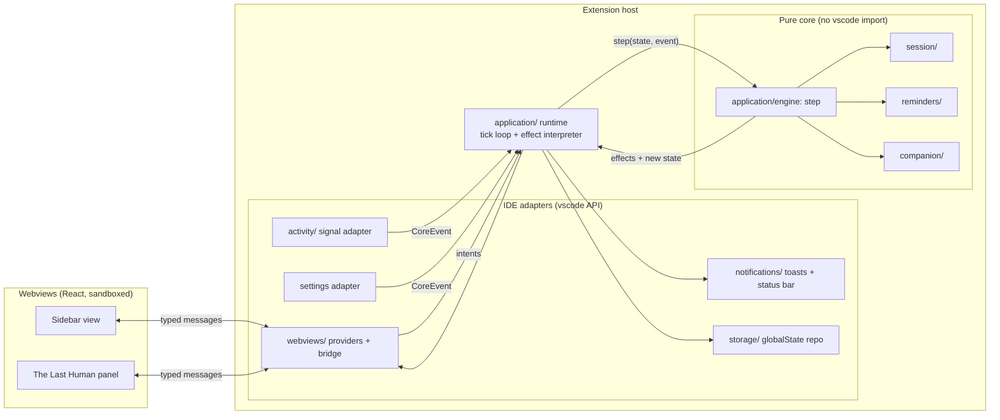
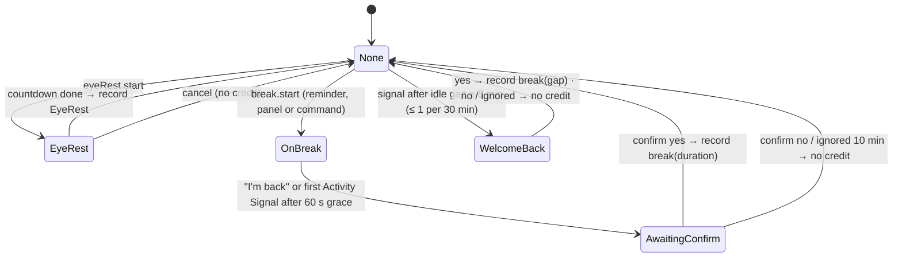
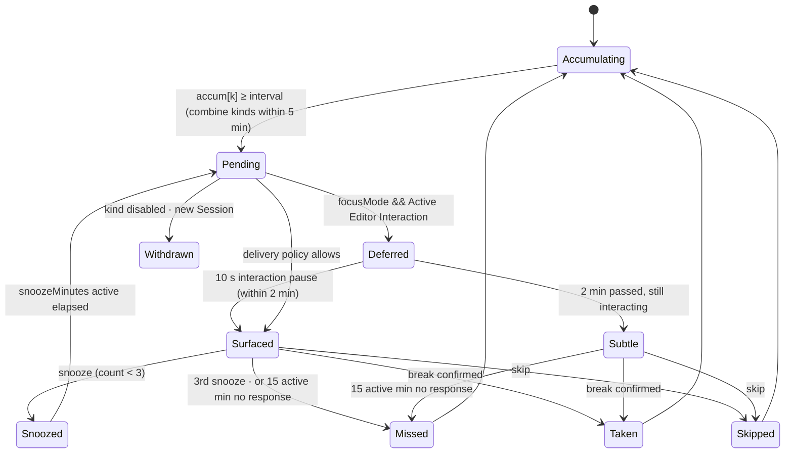
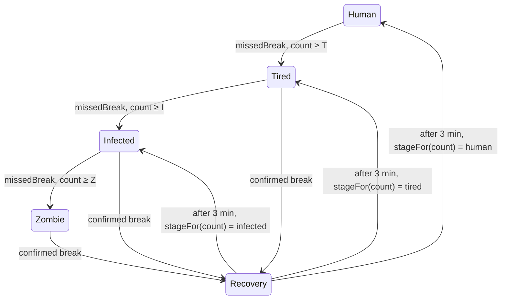

# Design Document — Graveyard Shift

> Status: **APPROVED** (decisions D1–D8 applied 2026-11-14) · Implements [requirements.md](./requirements.md)

## 1. Overview

Graveyard Shift is a VS Code-API extension for Kiro (verified base: Code OSS **1.131.0** in Kiro 1.4.154). A deterministic, pure **core** turns content-free events into state and side-effect requests. A thin **runtime** feeds it real clock and IDE events and carries out the effects. Two React Webviews render snapshots of that state and send back user intents.

Design goals, in priority order:

1. **Wellness, not productivity.** The product rewards breaks, never longer coding. It never shames.
2. **Honest signals.** Activity is an estimate of IDE interaction. Idle is not rest. Only the user confirms a break. Automation never counts as the user.
3. **Privacy by construction.** No module that touches IDE events ever receives content, paths or names.
4. **Testable time.** Every timing decision lives in pure functions that take time as input. Five-hour behaviour is tested in milliseconds.
5. **Gentle delivery.** Interruptions are bounded, deferrable, dismissible, and never forced.
6. **Crafted look.** A single consistent pixel-art character, with reduced motion as the default.

## 2. Approved decisions

| # | Decision |
|---|---|
| D1 | A Gap of **6 h** starts a new Session. No break is recorded. Pending occurrences are withdrawn (not counted). The Missed Break Count, stage and long-session state reset. Daily history and today's aggregates stay intact. |
| D2 | `focusMode` defers surfacing during Active Editor Interaction for up to **2 min**. If the user pauses for 10 s within that window, the reminder surfaces normally. Otherwise it gets **Subtle Delivery** (sidebar, status bar, live region) and is never upgraded later. Toasts use the standard notification API so the IDE's Do Not Disturb applies. Nothing bypasses it. |
| D3 | New settings: `soundVolume` (30 %) and `saveCheckInsLocally` (false). `longSessionMode` is `panel` \| `sidebar` \| `off`. Immersive fullscreen is a future, consent-gated enhancement only. |
| D4 | Count-based companion with ⚙ thresholds **Tired ≥ 1, Infected ≥ 3, Zombie ≥ 5** Missed Breaks. Each Break Reminder counts at most once. Snooze ⚙ is 10 min. The Last Human opens at most twice per stretch and twice per Session, with a 60-minute remind-later. Details in §4.7, §4.8 and §13. |
| D5 | Original placeholder sprites plus an animation pipeline built on a replaceable atlas: transparent RGBA PNG, fixed aligned frame grid, shared anchor, validated manifest (§7.5). |
| D6 | Code: MIT (`LICENSE`). Original artwork: CC BY 4.0, documented in `ASSETS.md` with a third-party asset table (§16). |
| D7 | All settings are `application` scope (user-level only). |
| D8 | The focused (Owner) window credits, writes and surfaces. Other windows adopt newer stored state on focus. If the handoff proves unreliable in Kiro, document the limitation rather than add fragile coordination (§8.3). |

## 3. Architecture



Dependency direction: Webview → typed bridge → application → domain. Domain modules (`session/`, `reminders/`, `companion/`, `application/engine.ts`, `application/selectors.ts`, `src/shared/`) import nothing from `vscode`, Node built-ins or the Webview. ESLint `no-restricted-imports` enforces this, and also bans network modules and globals everywhere (R20.2).

### 3.1 Folder layout

Follows `structure.md`. Three additions, each with a reason:

```
src/
  shared/                 # types used by host and webview; no runtime deps
    time.ts               # Instant, Clock
    config.ts             # EffectiveConfig, DEFAULTS, validateConfig
    constants.ts          # every † constant (§13)
    domain.ts             # ReminderKind, CompanionStage, ids, outcomes
    messages.ts           # protocol v1 unions + validators
    viewModel.ts          # CompanionViewModel (snapshot sent to webviews)
    copy.ts               # every user-facing string (R19.5)
  extension/
    activate.ts           # activation, disposal, command registration only
    activity/             # vscode events → content-free CoreEvents
    session/              # active-time accounting, idle, gaps, breaks, sessions (pure)
    reminders/            # occurrences, combine, snooze, delivery policy (pure)
    companion/            # stage machine + long-session policy (pure)
    application/          # ADDED: engine.ts (pure step), selectors.ts (pure), runtime.ts (impure loop)
    storage/              # versioned persistence, migrations, window handoff
    webviews/             # providers, HTML+CSP, host side of bridge
    notifications/        # ADDED: toast and status bar adapters (not webviews)
    demo/                 # ADDED: demo script + simulated clock driver
  webview/
    sidebar/              # entry + sidebar components
    last-human/           # entry + panel components
    components/           # CompanionSprite, ActionButton, LiveRegion, DemoBadge
    bridge.ts             # typed acquireVsCodeApi wrapper
    sound/cue.ts          # Web Audio synthesized cue
    styles/               # tokens.css, sidebar.css, last-human.css
assets/
  icons/                  # activity bar icon (monochrome SVG)
  sprites/                # atlas PNGs + manifest.json; src/ grid sources
scripts/                  # build-sprites.mjs
tests/unit/ tests/property/ tests/webview/ tests/integration/ tests/support/
```

- `application/` holds the root reducer that composes the domain modules, plus the runtime that drives it. The rule "UI → bridge → application → domain" needs a named application layer.
- `notifications/` keeps toast and status-bar code out of `webviews/`, which is about Webview lifecycles.
- `demo/` keeps simulation code isolated so it cannot be wired to real storage by accident.

## 4. Core domain model

### 4.1 Time

```ts
// src/shared/time.ts
export interface Instant {
  readonly mono: number; // ms, monotonic within one host process
  readonly wall: number; // ms since epoch
}
export interface Clock { now(): Instant }
```

The core never reads a clock. Each event carries an `Instant`. Tests use a `FakeClock` that can advance `mono` and `wall` independently to simulate sleep and clock changes. The runtime uses `SystemClock` (`performance.timeOrigin + performance.now()` and `Date.now()`). Local day keys come from an injected `localDay(wall): string`, so the core has no timezone dependency.

### 4.2 Events, state and effects

```ts
// src/extension/application/engine.ts (pure)
export type CoreEvent =
  | { type: 'tick'; at: Instant }
  | { type: 'signal'; source: SignalSource; at: Instant }
  | { type: 'focus'; focused: boolean; at: Instant }
  | { type: 'windowActive'; active: boolean; at: Instant }
  | { type: 'config'; config: EffectiveConfig; at: Instant }
  | { type: 'restored'; persisted: PersistedState; reason: 'startup' | 'handoff'; at: Instant }
  | { type: 'intent'; intent: UserIntent; at: Instant };

// Interaction indications only. None of these means "typing".
export type SignalSource = 'focus' | 'windowActive' | 'keyboardSelection' | 'mouseSelection' | 'webview';

export type Effect =
  | { type: 'surfaceReminder'; occurrence: OccurrenceView }   // toast (+ cue if a webview is visible)
  | { type: 'openLastHuman' } | { type: 'closeLastHuman' }
  | { type: 'notifyLongSession' }                              // mode = sidebar, or companion disabled
  | { type: 'playCue'; cue: 'reminder' | 'recovery' }
  | { type: 'persist'; urgency: 'now' | 'debounced' };

export interface StepResult { state: CoreState; effects: readonly Effect[] }
export function step(state: CoreState, event: CoreEvent): StepResult;
```

`CoreState` holds `config`, `session`, `breaks`, `reminders`, `companion`, `longSession`, `prompts`, `pause`, `history` and a monotonically increasing `seq` used for deterministic ids (`eye+movement#14`). There is no randomness in the core. Determinism (R6.7, R10.10) holds by construction, and property tests check it.

`step` runs the sub-reducers in a fixed order: **session accounting → breaks → reminders → long session → companion → delivery**. Only the delivery stage emits surfacing effects.

### 4.3 Activity accounting (`session/accounting.ts`)

```
state: focused, windowActive, lastSignal: Instant | null, lastInteraction: Instant | null,
       activeMs, stretchMs, accum[kind]

consistent(a, b) = (b.mono - a.mono) >= 0
               and (b.wall - a.wall) >= 0
               and |(b.wall - a.wall) - (b.mono - a.mono)| <= CLOCK_TOLERANCE (60 s)

on signal(src, at):                      # ticks count as signals only while focused && windowActive
  if paused or !focused: return
  if lastSignal and consistent(lastSignal, at) and not onBreak:
     gap = at.mono - lastSignal.mono
     if gap <= idleMs: credit(gap)       # activeMs, stretchMs, accum[k], today.activeMs += gap
  # otherwise the gap stays uncredited (idle, sleep or clock jump)
  if src in {keyboardSelection, mouseSelection}: lastInteraction = at
  maybeWelcomeBack(lastSignal, at)       # §4.5
  lastSignal = at

on focus(false, at): process as a final signal at `at`, then focused = false, lastSignal = null
on focus(true, at):  focused = true, then signal('focus', at)   # starts a new chain, credits nothing
```

What follows from this:

- **Conservative and monotonic.** Credit is final when the next signal arrives. The display can lag real activity by up to `idleMinutes`, but it never over-counts and never goes back (R4.4).
- **Sleep and resume.** macOS and Linux monotonic clocks pause during suspend while wall time advances. The mismatch exceeds the tolerance, so the interval is a Gap (R4.2).
- **Automation is excluded at the source.** The adapter never subscribes to document, save, file-system, active-editor or visible-range events. It drops selection changes of kind `Command` or `undefined` (R3.2). Agents opening files or applying edits therefore produce no signals. Keyboard or mouse selection changes indicate interaction, which may or may not be typing. Copy never calls it typing (R3.10).
- **Terminal and chat.** `WindowState.active` (available in Kiro's 1.131 base) covers interaction in the terminal or Kiro chat. It is still checked at runtime (R3.7).

### 4.4 Sessions, restarts and new sessions (`session/lifecycle.ts`)

Persisted state stores `lastSignalWall`, never `mono`, because `mono` is meaningless across processes. On `restored`:

| Wall gap since `lastSignalWall` | Behaviour |
|---|---|
| negative (clock moved back) | Resume the Session, no credit, no welcome-back prompt (R4.3, R5.9). |
| < 5 min | Resume silently, no credit (R4.5). |
| 5 min – 6 h | Resume and queue a welcome-back prompt for the first signal (R4.6, R5.8). |
| ≥ 6 h | **New Session** (below). |

A new Session (R4.7, D1) does the following:

```
session      ← { startedAtWall: at.wall, activeMs: 0, stretchMs: 0 }
reminders    ← accum = 0 for every kind; every pending/snoozed occurrence → outcome 'withdrawn'
               (no Missed Break, not surfaced; `seq` continues so ids stay unique)
companion    ← { count: 0, stage: 'human', recoveryUntil: null }
longSession  ← initial (no showings, no cooldowns, notAgain = false)
prompts      ← cleared
history      ← unchanged; today's summary gets sessions += 1
```

The same rule applies to in-process gaps detected on a signal.

### 4.5 Breaks (`session/breaks.ts`)



- Signals in the first 60 s of a break are ignored, so the click on "Take a break" (a Webview signal) or a last keystroke does not end it at once.
- Break duration is `endedAt.wall - startedAt.wall` when the interval is clock-consistent. Otherwise the confirmation asks without a number and offers "Less than 5 minutes" or "5 minutes or more".
- **Eye Rest** resets `accum.eye` only. It does not change the stretch or the count (R5.3, R10.4).
- **Short break (< 5 min)** resolves its source occurrence as *taken* and reduces the count by 1.
- **Meaningful Break (≥ 5 min)** resets `stretchMs` and every accumulator, resolves pending occurrences as *taken*, resets stretch-scoped long-session state, and reduces the count by 2. A **Long Break (≥ 15 min)** sets the count to 0.
- The eye-rest end is a deadline. The runtime schedules a one-shot timer at `nextDeadline(state)` (§6.1).
- While On Break, `credit()` is suspended.

### 4.6 Reminder scheduler and delivery (`reminders/`)



- **Occurrence.** `{ id, kinds, createdAt: Instant, createdAtActiveMs, delivery: 'pending'|'deferred'|'surfaced'|'subtle', deliveredAtActiveMs?, snoozes, snoozedUntilActiveMs?, outcome? }`. Each kind is in at most one live occurrence (R6.3). Once `outcome` is set it never changes, which makes "counts once" structural (R7.9, R8.5).
- **Combining (R6.4).** When kind *k* becomes due, every enabled kind *j* with `accum[j] ≥ interval[j] − 5 min` joins the occurrence. With the defaults, minute 60 produces one combined "look away, stretch, grab some water" reminder.
- **Active-time units.** Snooze, the 15-minute missed window and spacing are all measured in Active Time, so walking away never makes reminders pile up.
- **Missed Break accounting.** When an occurrence gets the outcome *skipped* or *missed* and includes movement or hydration, the companion receives one `missedBreak` event. Eye-only occurrences update only the eye stats.

**Delivery policy** (`reminders/delivery.ts`):

```
interacting(at) = lastInteraction != null && at.mono - lastInteraction.mono < INTERACTION_WINDOW (10 s)

canInterrupt(state) = focused && !paused && breaks.state == None && !lastHuman.open
                      && !demoHoldsReal && activeMs - lastSurfacedActiveMs >= SPACING (5 min)

decide(occ, at):
  if !canInterrupt: stay (sidebar shows it anyway)
  else if !config.focusMode or !interacting(at): SURFACE           # toast + cue
  else if at.mono - occ.createdAt.mono >= MAX_DEFER (2 min): SUBTLE  # no toast, no cue, never upgraded
  else: DEFER
```

The sidebar shows every Pending occurrence immediately (R7.1), so a reminder is never silently lost. The status bar switches to an attention state for `surfaced` and `subtle` occurrences.

### 4.7 Companion state machine (`companion/stage.ts`)

Input: `count` (Missed Break Count) and thresholds `T` < `I` < `Z` (⚙ defaults 1, 3, 5).

```
stageFor(count) = count >= Z ? zombie : count >= I ? infected : count >= T ? tired : human
cap             = Z + 2                                  (default 7)
```



| Event | Count change |
|---|---|
| Break Reminder ends *skipped* or *missed* | +1 (once per occurrence) |
| Last Human automatic showing ends without a break | +1 (once per showing) |
| Eye-only occurrence skipped or missed | 0 |
| Eye Rest confirmed | 0 |
| Confirmed break < 5 min | −1 |
| Meaningful Break (≥ 5 min) | −2 |
| Long Break (≥ 15 min) | set to 0 |

Rules:
- The count is clamped to `0..cap`.
- Going up, the stage moves at most one step per event (R10.5).
- Going down, the stage passes through Recovery when the starting stage is Tired or above, then settles on `stageFor(count)`. From Zombie (count 5–7), one Meaningful Break gives 3–5. That is Infected or Zombie, never Human (R10.7).
- If a Missed Break happens during Recovery, Recovery ends early. The stage settles on `stageFor(count before the miss)` and then applies the one-step rule.
- The stage is always derived from count and thresholds. If thresholds change, the stage is re-derived (one step at most going up), so there is no stored stage that can drift.

With the defaults, skipping every Break Reminder gives Tired at about 1 h, Infected at about 3 h and Zombie at about 5 h, which coincides with The Last Human. Leaving them unanswered is slower, since each becomes *missed* after 15 minutes. A user who takes the offered breaks stays Human. The visible arc comes from skipped breaks, not from hours worked.

Stage copy describes the companion. Drafts for `copy.ts`:

| Stage | Label | Line |
|---|---|---|
| Human | Feeling human | "Still warm. The odd break keeps it that way." |
| Tired | Getting tired | "Your companion is yawning. A short pause would help them." |
| Infected | Something's off | "A little green around the edges. A few minutes away could turn this around." |
| Zombie | Fully undead | "Your companion has gone full zombie. A break brings them back." |
| Recovery | Coming back | "Colour's returning. Welcome back." |

### 4.8 The Last Human policy (`companion/longSession.ts`)

```ts
interface LongSessionState {
  autoShowsThisSession: number;        // ≤ LH_MAX_PER_SESSION (2)
  autoShowsThisStretch: number;        // ≤ LH_MAX_PER_STRETCH (2)
  remindLaterAtStretchMs: number | null;
  closedForStretch: boolean;           // Dismiss or tab closed
  notAgainThisSession: boolean;
  open: null | { showingId: string; preview: boolean; counted: boolean };
  waitingForPause: boolean;            // focusMode deferral → subtle notice meanwhile
}
```

```
thresholdReached = stretchMs ≥ longSessionHours × 3.6e6
eligible = mode != off && thresholdReached && !notAgainThisSession && !closedForStretch
           && autoShowsThisSession < 2
           && (autoShowsThisStretch == 0
               || (autoShowsThisStretch == 1 && remindLaterAtStretchMs != null && stretchMs ≥ remindLaterAtStretchMs))
```

- When `eligible` and `canInterrupt`: if focusMode and interacting, set `waitingForPause` (the sidebar shows the long-session message subtly) and open at the next 10 s pause (R11.4). Otherwise emit `openLastHuman` (mode `panel` with the companion enabled) or `notifyLongSession` (mode `sidebar`, or the companion disabled).
- Outcomes. Each outcome adds +1 to the Missed Break Count once per showing, unless it led to a confirmed break:
  - **Remind me in an hour:** `remindLaterAtStretchMs = stretch + 60 min`.
  - **Dismiss or tab closed:** `closedForStretch = true`.
  - **Not again this session:** `notAgainThisSession = true`.
- **Take a break** starts the break flow and emits `closeLastHuman`. If the break is not confirmed, the showing counts as ended without a break.
- A **Meaningful Break** resets `stretchMs`, `autoShowsThisStretch`, `remindLaterAtStretchMs` and `closedForStretch`. `autoShowsThisSession` and `notAgainThisSession` persist until a new Session.
- If `thresholdReached` holds but the panel is not `eligible`, the view model carries a quiet `longSessionNote` (R11.9).
- An Eye Rest never touches `stretchMs`.
- **Preview** sets `open.preview = true`. Preview intents are no-ops apart from closing.

## 5. View model

The core never sends raw state to Webviews. The pure selector `selectViewModel(state, at)` produces:

```ts
// src/shared/viewModel.ts
export interface CompanionViewModel {
  protocol: 1;
  demo: null | { speedLabel: string };            // e.g. "1 s = 3 min"
  companion: { enabled: boolean; stage: CompanionStage; label: string; line: string };
  motion: 'full' | 'reduced';                     // host setting; webview also ORs in the OS media query
  sound: { enabled: boolean; volume: number };    // 0..1
  status: 'active' | 'idle' | 'unfocused' | 'onBreak' | 'eyeRest' | 'paused';
  reminder: null | { id: string; kinds: ReminderKind[]; title: string; body: string; subtle: boolean };
  snoozed: null | { kinds: ReminderKind[]; aboutMinutes: number };
  eyeRest: null | { endsAtWall: number };
  onBreak: null | { id: string; startedAtWall: number };
  confirmBreak: null | { id: string; aboutMinutes: number | null };
  welcomeBack: null | { id: string; aboutMinutes: number };
  checkIn: null | { id: string };
  longSession: null | { showingId: string; aboutHours: number; thresholdHours: number; preview: boolean };
  longSessionNote: null | { aboutHours: number };
  stats: { activeMinutesEstimate: number; minutesSinceBreak: number; breaksToday: number; eyeRestsToday: number };
}
```

Strings come from `copy.ts` in the selector, so the Webview makes no business or wording decisions (R15.4, R19.5). Stats are framed around breaks. Active time appears only as "about N h of estimated IDE activity", never as a goal or record (R19.4). Countdown rendering uses `endsAtWall` for display only.

## 6. Host runtime and adapters

### 6.1 Runtime (`application/runtime.ts`)

```ts
class Runtime implements Disposable {
  constructor(deps: { clock: Clock; store: StateStore; effects: EffectSink; config: EffectiveConfig; localDay: (wall: number) => string })
  dispatch(event: CoreEvent): void   // step → apply effects → publish view model if changed
}
```

- One `setInterval` tick every 15 s, plus one one-shot `setTimeout` for `nextDeadline(state)` (eye-rest end, recovery end, deferral end, pause end) (R18.2).
- After each step, the runtime publishes the view model to visible Webviews only if it changed (structural compare), and updates the status bar.
- `EffectSink` is an interface. The production sink calls the notification, Webview, storage and sound adapters. The demo runtime gets a sink with in-memory storage and "[Demo]" labelling. Unit tests use a recording sink.
- Exceptions inside an effect handler are caught, logged with the effect type only, and do not stop the loop (R18.4).

### 6.2 Activity adapter (`activity/signals.ts`)

| VS Code API | CoreEvent | Data passed on |
|---|---|---|
| `window.onDidChangeWindowState` (`focused`) | `focus` | boolean only |
| `window.onDidChangeWindowState` (`active`) | `windowActive` | boolean only |
| `window.onDidChangeTextEditorSelection` with kind `Keyboard` / `Mouse` | `signal('keyboardSelection' \| 'mouseSelection')` | source only. The event's editor, document and selections are never read. |
| Webview `ui/interaction` message | `signal('webview')` | source only |

Not subscribed: document changes, saves, file-system watchers, active-editor changes, visible ranges, terminals' data. A 1 s coalescer runs in the adapter (R3.8). A unit test asserts that the adapter's output objects have no keys besides `type`, `source`, `at` and the booleans.

### 6.3 Notifications and status bar (`notifications/`)

- Toasts use `window.showInformationMessage(text, 'Take a break', 'Snooze', 'Skip')`, non-modal and information severity only. Kiro's Do Not Disturb mode (inherited from VS Code) then hides them into the notification centre (R7.5). There is no API to read the DND state, so cues and the panel cannot follow it. The user controls those with the mute toggle and `longSessionMode`, and §14 records this.
- When the promise resolves, it dispatches an intent carrying the occurrence id. `undefined` means closed, which is treated as no response (R7.7). VS Code cannot close a toast programmatically, so a stale toast's later click is ignored by id (R7.8, R21.4).
- The status bar item shows a codicon plus short text: `Human · 42m since break`, attention state `$(bell-dot) Break reminder`, or `Paused`. It has an accessible tooltip and the command `graveyardShift.openCompanion`.

### 6.4 Settings adapter

The adapter reads `graveyardShift.*` through `workspace.getConfiguration` and runs `validateConfig(raw): { config, problems[] }` from `src/shared/config.ts`. That module exports `BASELINE_DEFAULTS`, which must deep-equal `config/defaults.json` (R20.3), and `DEFAULTS` (baseline plus the R2.2 extensions). `onDidChangeConfiguration` dispatches a `config` event. Every setting is `scope: application` (R2.3).

| Setting | Range |
|---|---|
| eye.minutes | 5–120 |
| movement.minutes, hydration.minutes | 15–240 |
| longSessionHours | 1–12 |
| idleMinutes | 1–30 |
| soundVolume | 0–100 |
| snoozeMinutes | 5–60 |
| tired / infected / zombie thresholds | 1–20 / 2–30 / 3–40, strictly increasing, otherwise all three use their defaults (R2.8) |

## 7. Webviews

### 7.1 HTML and CSP (`webviews/html.ts`)

```
default-src 'none';
script-src 'nonce-${nonce}' ${webview.cspSource};
style-src ${webview.cspSource};
img-src ${webview.cspSource};
font-src ${webview.cspSource};
```

There is no `connect-src`, `media-src`, `unsafe-inline` or `unsafe-eval`. `${cspSource}` in `script-src` allows Vite's ES-module chunks, which are imported by the nonce'd entry, to load from the packaged bundle. The nonce is 16 random bytes encoded as base64url per HTML load. `buildWebviewHtml()` is a pure function, unit-tested for the policy. Options: `enableScripts: true`, `enableCommandUris: false`, `localResourceRoots: [dist/webview, assets]`, `retainContextWhenHidden: false`. The Webview re-requests a snapshot on `ready`. Sound is synthesized, so `media-src` is not needed.

### 7.2 Message protocol (`src/shared/messages.ts`)

| Direction | Type | Payload |
|---|---|---|
| W → H | `ready` | `{ surface: 'sidebar' \| 'lastHuman' }` |
| W → H | `intent` | `UserIntent` (below) |
| W → H | `ui/interaction` | none (activity signal) |
| H → W | `snapshot` | `CompanionViewModel` |
| H → W | `cue` | `{ cue: 'reminder' \| 'recovery' }` |

`UserIntent` kinds:
- `reminder.takeBreak|snooze|skip {occurrenceId}`
- `eyeRest.start|cancel`
- `break.start`, `break.end {breakId}`, `break.confirm {breakId, confirmed, atLeastFiveMinutes?}`
- `welcomeBack.answer {promptId, tookBreak}`
- `checkIn.answer {checkInId, answer}`
- `longSession.takeBreak|remindLater|dismiss|notAgain {showingId}`
- `sound.setEnabled {enabled}`
- `pause.resume`

Every message is `{ v: 1, type, ...payload }`. Validators are hand-written type guards, with no schema library, to keep the bundle small. They check exact keys, literal unions and string length (ids are at most 64 characters, `[A-Za-z0-9#+-]`). Invalid messages are dropped and logged by `type` only (R15.3). Both sides import the same module.

### 7.3 Sidebar UI (`src/webview/sidebar/`)

Hierarchy follows `visual-style.md`: **sprite first, self-care action second, stats third.**

```
┌ DEMO · simulated time ┐            (only in demo)
│   [ companion scene ]  │           night-sky frame, sprite at integer scale
│   Getting tired        │           stage label (text, not colour only)
│   "Your companion is yawning…"
│ ┌ Time to look away ───────────┐   reminder card; LiveRegion announces it
│ │ [Take a break] [Snooze] [Skip]│
│ └──────────────────────────────┘
│  2 breaks today · 38 min since a break · about 1 h 40 m estimated IDE activity
│  [sound toggle]   [Pause]           (codicons, not emoji)
```

- Components: `CompanionScene`, `StageLabel`, `ReminderCard`, `EyeRestCountdown`, `BreakPanel`, `ConfirmBreak`, `WelcomeBack`, `CheckIn`, `LongSessionNote`, `StatsLine`, `Controls`, `LiveRegion`, `DemoBadge`. Each takes props from the view model and returns intents through one `useBridge()` hook.
- Single column on an 8 px grid. Sprite scale is the largest integer that fits, between 3× and 6× of 32 px. At 240 px the actions wrap to a column.
- New content never steals focus. Buttons are native `<button>` elements.

### 7.4 The Last Human panel (`src/webview/last-human/`)

- Opened with `createWebviewPanel('graveyardShift.lastHuman', title, { viewColumn: ViewColumn.Beside, preserveFocus: true })`. Opening beside the active editor keeps that editor visible and focused, so typing is not hijacked and no editor is closed or moved (R11.12). One instance only. `onDidDispose` dispatches `longSession.dismiss` unless an action already closed it.
- Scene: a large 160×90 px pixel-art graveyard at dusk. The companion, the last human, stands in the foreground while a slow zombie horde gathers at the fence. It is scaled to the largest integer factor that fits and letterboxed in ink. Full motion plays a non-flashing intro of about 2 s (fog drift, lantern flicker below 3 Hz) and then a calm loop. Reduced motion shows one static frame. The scene is `role="img"` with a text alternative.
- Copy (draft): **The Last Human** · "You've been at it for about 5 h 10 m without a longer break. That's the limit you set. The horde can wait." Then the four actions. Escape dismisses. The primary action gets initial focus when the panel gains focus (R13.8).

### 7.5 Sprite atlas and animation pipeline (D5)

**Atlas contract** (`assets/sprites/<name>.atlas.json`):

```json
{
  "version": 1,
  "image": "companion.png",
  "frame": { "w": 32, "h": 32 },
  "anchor": { "x": 16, "y": 31 },
  "animations": {
    "human.idle":   { "frames": [[0,0],[1,0],[2,0],[1,0]], "frameMs": 450, "loop": true, "static": [0,0] },
    "tired.idle":   { "frames": [[0,1],[1,1]], "frameMs": 600, "loop": true, "static": [0,1] },
    "recovery.in":  { "frames": [[0,4],[1,4],[2,4]], "frameMs": 200, "loop": false, "static": [2,4] }
  }
}
```

- Frames sit on a fixed grid of `frame.w × frame.h` cells addressed by `[col,row]`, so every frame is aligned by construction. One shared `anchor` (the feet) keeps the character from jittering between frames and stages.
- The image is a **transparent RGBA PNG**. The placeholder generator writes colour type 6 with full alpha.
- Required animations: `<stage>.idle` for all five stages, each with a `static` frame. Optional: `recovery.in`, `<stage>.blink`.
- `tests/unit/sprites.test.ts` validates every atlas: PNG signature and colour type 6, image size a whole multiple of the frame size, all frame cells inside the image, required animations present, `frameMs ≥ 150` (keeps any change under 3 Hz, below the flash limit in R12.3).
- To replace the placeholders with a polished atlas, drop in a new PNG and JSON that pass the same test. No code change is needed. Aseprite exports map onto this grid format.

**Rendering** (`CompanionSprite`):
- A `<div role="img" aria-label=…>` with the atlas as `background-image` (allowed by `img-src`), `image-rendering: pixelated`, and `background-size` at an integer scale.
- In full motion, a small frame stepper sets `background-position` through the CSSOM on a timer. CSSOM changes are not blocked by CSP. The stepper stops when `document.visibilityState === 'hidden'` (R18.5).
- In reduced motion (the setting or the OS media query), the stepper never starts and only the `static` frame is shown.

**Placeholder authoring:** `assets/sprites/src/*.grid.txt` holds one character per pixel, with `.` for transparent, mapped through a palette header. `scripts/build-sprites.mjs` packs them into the atlas PNG using only Node's `zlib` and writes the JSON. Placeholders are original work, licensed CC BY 4.0 (§16).

Art direction: one silhouette and set of proportions across stages. The stage shows through skin tone, posture, eyes and small props such as a mug or a bandage. Recovery reuses the Human base while colour returns.

### 7.6 Sound (`src/webview/sound/cue.ts`)

The cue is synthesized with Web Audio, so there is no audio file to license. It is a two-note soft sine or triangle chime, with a 150 ms attack, 1.2 s total length, and peak gain equal to `volume × 0.5`. It plays only on a `cue` message, only if `sound.enabled` is true and the Webview is visible. It never plays for Subtle Delivery (R12.5). If the `AudioContext` is `suspended`, the Webview tries `resume()` once and otherwise stays silent (R12.8). The context is resumed on the user's first click in the Webview.

### 7.7 Theme and contrast

The companion scene is always a fixed "night" frame in the steering palette, like a window into the graveyard. Controls and text outside the scene use VS Code theme tokens (`--vscode-button-*`, `--vscode-foreground`, `--vscode-focusBorder`), so light, dark and high-contrast themes look native. In high-contrast themes the scene gets a `--vscode-contrastBorder` outline.

Measured contrast (WCAG 2.x):

| Foreground | on Ink `#191E1B` | on Panel `#252C26` | Use |
|---|---|---|---|
| Bone `#EBE7DA` | 13.66 | 11.57 | primary text in scene |
| Muted `#B3BDB0` | 8.71 | 7.38 | secondary text |
| Olive `#9AAD86` | 7.00 | 5.93 | green accent, text OK |
| Rust `#B47C66` | 4.84 | **4.10** | warm accent: body text on Ink only. On Panel, use only for large text or non-text (3:1). |

At most one warm and one green accent are visible at a time. Rust is reserved for Zombie and The Last Human, and Olive for Human and Recovery.

## 8. Persistence (`storage/`)

### 8.1 Schema

```ts
interface PersistedStateV1 {
  schemaVersion: 1;
  revision: number;                    // +1 on every write (multi-window handoff)
  session: { startedAtWall: number; lastSignalWall: number | null; activeMs: number; stretchMs: number };
  reminders: { accum: Record<ReminderKind, number>; live: OccurrenceRecord[]; lastSurfacedActiveMs: number; seq: number };
  companion: { count: number; recoveryUntilWall: number | null };
  longSession: LongSessionRecord;      // §4.8 without `open`
  prompts: { lastWelcomeBackWall: number | null; lastCheckInActiveMs: number | null };
  history: DailySummary[];             // ≤ 30 days, newest last
  checkIns?: { atWall: number; answer: CheckInAnswer }[];  // only if saveCheckInsLocally
}
interface DailySummary {
  day: string; activeMs: number; sessions: number; breaks: number; meaningfulBreaks: number;
  eyeRests: number; remindersSurfaced: number; snoozed: number; skipped: number; missed: number;
}
```

- Stored under one `globalState` key, `graveyardShift.state`. `migrate(raw: unknown): PersistedStateLatest | null` runs a chain of `vN → vN+1` functions and then validates. Unknown, newer or corrupt data is discarded (logged by reason only) and the extension starts fresh.
- A schema snapshot test asserts that no field can hold paths, names or content (R14.2).
- Day rollover appends a new `DailySummary`. Entries older than 30 days are pruned (R14.4). A new Session never alters history (D1).

### 8.2 Write policy

Debounced 30 s for accrual. Immediate after outcomes, surfacings, breaks, settings-driven resets and **focus loss**. Best effort in `deactivate`. Clear Local Data asks for modal confirmation, then calls `globalState.update(key, undefined)` and dispatches a fresh state. Demo and Preview never touch the store. The demo runtime receives a `MemoryStore`.

### 8.3 Multiple windows (D8, R21)

Every window runs its own runtime. Only the **Owner Window** (focused) does any work that matters:

1. **Credits:** an unfocused window credits nothing (§4.3), so time is never double-counted.
2. **Writes:** the runtime persists only while focused, plus one immediate write on focus loss.
3. **Adopts:** on `focus(true)`, the runtime reads the store. If `stored.revision > local.revision`, it dispatches `restored{reason:'handoff'}` before the focus event. It re-checks once after 1 s (`HANDOFF_RECHECK_MS`) in case the previous owner's blur write landed late.
4. **Surfaces:** only a focused window surfaces (R7.6). Occurrence `delivery` is persisted immediately on surfacing, so the next owner sees `surfaced` or `subtle` and does not surface it again (R21.3).
5. **Stale actions:** a click on an old toast in window A focuses A, which adopts the shared state first. The intent is then ignored if that occurrence already has an outcome (R21.4).

Task 10 verifies in Kiro that `globalState` writes from one window are visible to another (VS Code shares global storage across windows). If the handoff is unreliable, the fallback is documented in the README: each window keeps its own counters, crediting stays focus-gated so nothing is double-counted, and the limitation is stated plainly (R21.5). Locks and IPC are not used.

## 9. Demo simulation (`demo/`)

- A second `Runtime` with `SimulatedClock` (advanced by a real timer, e.g. 1 real second = 3 simulated minutes), `MemoryStore`, and a `DemoEffectSink` that prefixes "[Demo]" and sets `viewModel.demo`.
- A script injects synthetic interaction signals and, at chosen points, auto-skips Break Reminders. The companion walks Human → Tired → Infected → Zombie, then the long-session threshold opens "The Last Human (Demo)" within 120 s (R16.4). The presenter can press Take a break. A simulated 6-minute break plays in about 3 s and is confirmed automatically, labelled "simulated", to show Recovery.
- While the demo runs, the real runtime keeps estimating with `demoHoldsReal = true` (R16.3). Demo state is never persisted.

## 10. Commands and contributions

`package.json` contributes:

- `viewsContainers.activitybar`: `graveyardShift` (pixel tombstone icon, monochrome SVG).
- `views.graveyardShift`: `graveyardShift.companion` (type `webview`).
- Commands (category "Graveyard Shift"): `openCompanion`, `takeBreak`, `startEyeRest`, `pause` (quick pick), `resume`, `checkIn`, `previewLastHuman`, `startDemo`, `stopDemo`, `resetSettings` (modal), `clearData` (modal).
- `configuration`: settings from R2.1–R2.2, all `scope: application`.
- `activationEvents`: `onStartupFinished`.
- `engines.vscode`: `^1.90.0`. Kiro 1.4.154 reports Code OSS 1.131.0 (`vsCodeVersion` in its `product.json`), and 1.90 includes `WindowState.active` (added in 1.89). `@types/vscode` is pinned to `~1.90.0` so the build cannot use newer APIs by accident.

## 11. Error handling

| Situation | Behaviour |
|---|---|
| Corrupt or unknown persisted data | Discard, start fresh, log the reason only. |
| Invalid setting value | Clamp or use the default, one warning per setting per Session. |
| Invalid Webview message | Drop it, log its type. |
| Webview fails to resolve | Continue the core and use toasts. |
| Effect handler throws | Log the effect type, continue, show at most one error toast per Session. |
| `globalState.update` rejects | Retry on the next debounced write and log once. |
| Audio unavailable | Stay silent. |
| Wall clock moves backwards | No credit, no prompt, nothing decreases. |

## 12. Testing strategy

**Unit tests** (Vitest, `tests/unit/`), with the core driven by `FakeClock`:
- accounting: idle boundary (gap = idle exactly credits; idle + 1 ms does not), focus loss mid-gap, coalescing, `Command` and `undefined` selection kinds ignored, heartbeat only while focused and active.
- time integrity: sleep (mono +1 min, wall +2 h), clock backwards, restart gaps at 4:59 min / 5:00 min / 5:59:59 h / 6:00 h. A new Session withdraws pending items, zeroes the count and keeps history.
- breaks: eye rest done or cancelled, break confirm yes or no, 4:59 vs 5:00 break, 60 s grace, welcome-back rate limit.
- reminders and delivery: due at interval, combining, spacing, focus-mode deferral, pause → surface, 2 min → subtle and never upgraded, snooze ×3 → missed, 15-minute missed exactly once, disable withdraws, interval change without floods, stale ids ignored.
- companion: default thresholds 1/3/5, custom thresholds, invalid ordering falls back, cap, eye-only misses ignored, one step up per event, Recovery timing, Zombie + Meaningful Break ≠ Human, Long Break → Human.
- long session: threshold, remind-later re-show once, dismiss closes for the stretch, not-again, session cap 2, meaningful break resets stretch scope, eye rest does not reset, preview has no effect, subtle wait during interaction.
- config: `BASELINE_DEFAULTS` deep-equals `config/defaults.json`, and package.json contributions equal `DEFAULTS` and are all `application` scope.
- storage: migration fixtures, corrupt input, clear, 30-day pruning, revision handoff.
- messages: validators reject extra keys, wrong literals, long ids, wrong version.
- sprites: atlas contract (§7.5).
- html: CSP contains `default-src 'none'` and the nonce, and has no `unsafe-*` or `connect-src`.

**Property tests** (fast-check, `tests/property/`). Generators produce random event sequences with mono/wall drift, backwards wall jumps, focus toggles, intents with random or stale ids, and config changes. Invariants, mapped to `docs/03-TEST-MATRIX.md`:
1. `activeMs`, `stretchMs` and `accum[k]` never decrease except at the defined resets, and are never negative.
2. Credited time between two events is never more than their monotonic delta, and is 0 when unfocused, paused, on break or inconsistent.
3. At most one live occurrence per kind. Surfacings are at least 5 active minutes apart. Each occurrence surfaces at most 3 times.
4. `stretchMs` resets only on a confirmed break of at least 5 minutes or a new Session. Eye Rests and idle never reset it.
5. The stage always equals a valid derivation from the count. It rises at most one step per event. Each occurrence or showing adds to the count at most once.
6. The Last Human auto-opens at most 2 times per stretch and per Session, never inside its cooldown, and at most one is open.
7. Determinism: replaying the same sequence gives identical states and effects.
8. Idempotency: duplicating any intent event changes nothing after the first.
9. A demo runtime fed any sequence leaves the real store untouched.
10. Two simulated windows sharing a `MemoryStore` with alternating focus never credit the same interval twice and never surface the same occurrence twice.

**Integration tests** (`@vscode/test-cli` + `@vscode/test-electron`, `tests/integration/`), run against VS Code because Kiro has no test harness: activation, view and commands registered, configuration defaults, status bar present, and deactivation disposing every subscription and timer.

**Webview tests** (`tests/webview/`, Vitest + jsdom + Testing Library): accessible names, keyboard operation, live-region announcements, the reduced-motion class from the setting or the OS media query, and intents posted with the right ids.

**Manual checks** in real Kiro, recorded in `docs/manual-checks.md` with date, OS and Kiro version:
- install and uninstall the VSIX, reload
- sidebar at 240, 320 and 400 px; light, dark and HC themes; VoiceOver pass
- system sleep and wake
- a Kiro agent editing and opening files while hands-off (expect no signals)
- Do Not Disturb on: toasts are hidden
- OS reduced motion, OS muted
- two windows
- non-ASCII strings in the UI

## 13. Constants and defaults

⚙ = user setting (R2.2), † = constant in `src/shared/constants.ts`. Tests import these rather than repeating literals.

| Name | Value | Where used |
|---|---|---|
| ⚙ `snoozeMinutes` | 10 min active | reminders |
| ⚙ `tired/infected/zombieAfterMissedBreaks` | 1 / 3 / 5 | companion |
| ⚙ `soundVolume` | 30 % | sound |
| † `TICK_MS` | 15 s | runtime |
| † `COALESCE_MS` | 1 s | activity adapter |
| † `CLOCK_TOLERANCE_MS` | 60 s | accounting |
| † `INTERACTION_WINDOW_MS` | 10 s | delivery (interaction and pause) |
| † `MAX_DEFER_MS` | 2 min | delivery |
| † `EYE_REST_MS` | 20 s | breaks |
| † `BREAK_END_GRACE_MS` | 60 s | breaks |
| † `MEANINGFUL_BREAK_MS` / `LONG_BREAK_MS` | 5 / 15 min | breaks, companion |
| † `CONFIRM_TIMEOUT_MS` | 10 min | break confirmation |
| † `WELCOME_BACK_MIN_GAP_MS` / `WELCOME_BACK_RATE_MS` | 5 min / 30 min | prompts |
| † `SESSION_RESET_GAP_MS` | 6 h | lifecycle |
| † `COMBINE_WINDOW_MS` / `SPACING_MS` | 5 / 5 min active | reminders |
| † `MAX_SNOOZES` | 2 re-surfacings (3rd snooze → missed) | reminders |
| † `MISSED_AFTER_MS` | 15 min active | reminders |
| † `SHORT_BREAK_CREDIT` / `MEANINGFUL_BREAK_CREDIT` | 1 / 2 | companion |
| † `COUNT_CAP_OFFSET` | 2 (cap = zombie + 2) | companion |
| † `RECOVERY_DISPLAY_MS` | 3 min | companion |
| † `LH_REMIND_LATER_MS` | 60 min active | long session |
| † `LH_MAX_PER_STRETCH` / `LH_MAX_PER_SESSION` | 2 / 2 | long session |
| † `CHECKIN_MIN_SPACING_MS` | 2 h active | check-in |
| † `HISTORY_DAYS` | 30 | storage |
| † `PERSIST_DEBOUNCE_MS` / `HANDOFF_RECHECK_MS` | 30 s / 1 s | storage |

## 14. Risks and known limitations

| Risk | Mitigation |
|---|---|
| Kiro's extension compatibility checks (known past Open VSX issues) | `engines.vscode ^1.90.0` against Kiro's Code OSS 1.131.0. Install the VSIX in Kiro in task 1. |
| `WindowState.active` inactivity delay is unknown. | Measure it in Kiro during task 7 and record it. |
| Agent-driven selection changes might report kind `Keyboard`. | Manual check with a Kiro agent editing while hands-off, in task 7. If it happens, also require `WindowState.active` for selection signals. |
| Do Not Disturb state cannot be read by extensions. | Toasts follow DND automatically. Cues and the panel do not. The user has a mute toggle and `longSessionMode`. Documented in the README. |
| Webview autoplay may block audio. | Resume on first interaction, otherwise silent. Verified in task 14. |
| `globalState` cross-window freshness | §8.3 approach. Verified in task 10. Documented fallback. |
| `deactivate` writes may not finish. | At most 30 s of accrual is lost, which errs on the low side. |
| Terminal-only work without `WindowState.active` is under-counted. | Errs toward fewer reminders. Documented. |
| The verify hook fires only when Kiro marks a spec task complete. | Trigger fixed to `PostTaskExec` (R20.7). Its firing is confirmed in the Kiro UI once `verify` exists. `npm run verify` is always also run directly, so the hook is never the only evidence. |

## 15. Dependencies

- **Runtime:** `react`, `react-dom`.
- **Dev:** `typescript`, `esbuild` (host bundle), `vite` + `@vitejs/plugin-react` (webview bundle), `vitest`, `fast-check`, `jsdom`, `@testing-library/react`, `eslint` + `@eslint/js` + `typescript-eslint` + `eslint-plugin-react-hooks` + `globals`, `@types/vscode@~1.90.0`, `@types/node`, `@types/react`, `@types/react-dom`, `@vscode/vsce`. `@vscode/test-cli` and `@vscode/test-electron` are added in task 17.
- There is no state library, schema library, analytics, or network client.

## 16. Licensing (D6)

- `LICENSE`: MIT, covering all source code.
- `ASSETS.md` holds:
  1. a statement that original artwork owned by the project (sprites, icons, scenes) is licensed under **CC BY 4.0**, with the attribution line to use;
  2. a table of every asset file with its author, origin and licence;
  3. a **third-party assets** table, empty unless something is added, recording source URL, author and licence for each item. Nothing is added without a compatible licence.
- The sound cue is synthesized in code, so it is covered by MIT. No fonts are bundled; the Webviews use the editor's font tokens.
- `package.json` `license` is `MIT`. The VSIX includes `LICENSE` and `ASSETS.md`.
