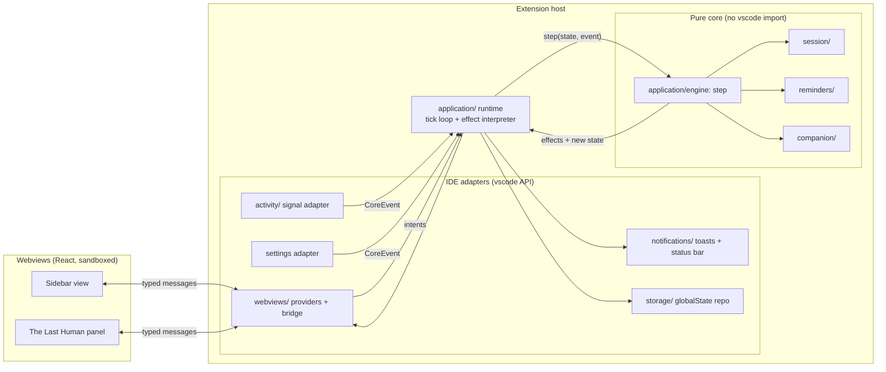
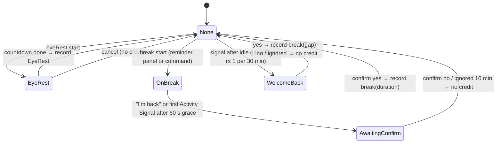
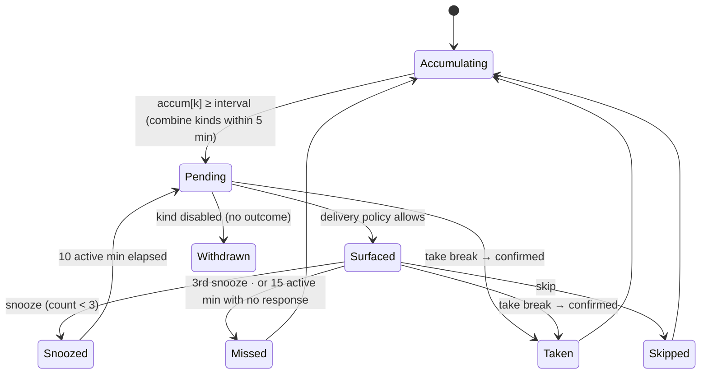
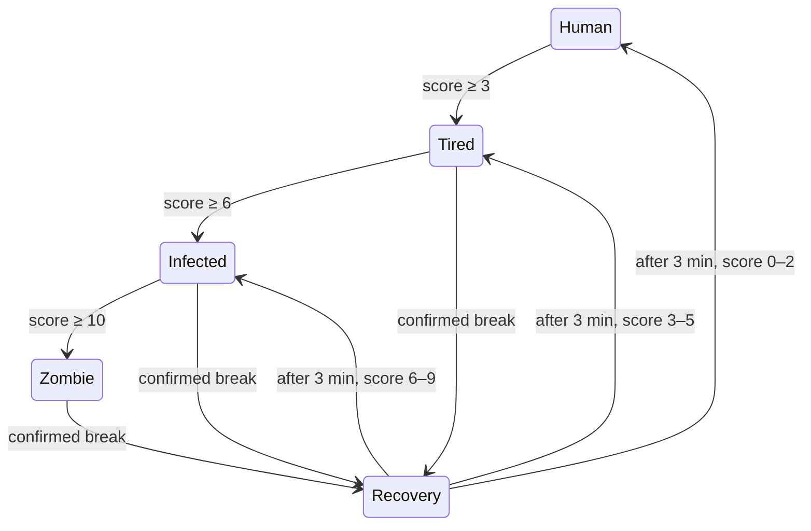

# Design Document — Graveyard Shift

> Status: **DRAFT for review** · Implements [requirements.md](./requirements.md)

## 1. Overview

Graveyard Shift is a VS Code-API extension for Kiro. A deterministic, pure **core** turns content-free events into state and side-effect requests. A thin **runtime** feeds it real clock and IDE events and carries out the effects. Two React Webviews render snapshots of that state and send back user intents.

Design goals, in priority order:

1. **Honest signals.** Activity is an estimate; idle is not rest; only the user confirms a break.
2. **Privacy by construction.** No module that touches IDE events ever receives content, paths or names.
3. **Testable time.** Every timing decision lives in pure functions that take time as input. Five-hour behaviour is tested in milliseconds.
4. **Gentle delivery.** Interruptions are bounded, deferrable, and always dismissible.
5. **Crafted look.** A single consistent pixel-art character, with reduced motion as the default.

## 2. Decisions needing your review

These choices affect behaviour and copy. The rest of this document assumes the proposed option.

| # | Question | Proposed option | Alternatives |
|---|---|---|---|
| D1 | What happens to the Unbroken Stretch after a very long absence that the user never confirmed as a break (e.g. overnight)? | A gap of **6 h** starts a new Session. Counters reset, but no break is recorded in stats. Shorter gaps keep the stretch and show a welcome-back prompt. | Carry the stretch forward indefinitely (risks a Last Human warning an hour into the next morning); or start a new Session at local midnight. |
| D2 | What does `focusMode` mean? | Defers toasts, sounds and the panel during a Typing Burst until a 10 s pause, never more than 2 min. With it off, reminders surface immediately. | Treat focus mode as "sidebar and status bar only, no toasts". |
| D3 | New settings and enum values beyond `defaults.json` | Add `experience.soundVolume` (30 %) and `reminders.saveCheckInsLocally` (false). `longSessionMode` enum: `panel` \| `sidebar` \| `off`. | Keep volume as a fixed internal constant (but the first prompt requires user-controllable volume). |
| D4 | Tunable constants (§13): score weights, thresholds, snooze length, cooldowns, break lengths | As listed in §13. | Any values. These are product calls, not technical ones. |
| D5 | Who produces the final sprite art? | Kiro builds the sprite pipeline and original placeholder sprites authored as palette-indexed text grids. You replace them with hand-drawn Aseprite sheets later using the same manifest format. | Sprites only from your Aseprite files; or keep the grid-authored sprites as final. |
| D6 | Repository licence | MIT for code, with asset licence stated in `ASSETS.md` (e.g. CC BY 4.0 if you want reuse with credit). | Apache-2.0; separate asset licence. |
| D7 | Settings scope | `application` scope, so a cloned repo's `.vscode/settings.json` cannot change your wellness settings. | `window` scope, which allows per-workspace settings. |
| D8 | Several Kiro windows open at once | The focused window owns the state. It re-reads stored state when it gains focus, and only it writes. Remaining risk is documented. | Treat each window independently (double reminders); or ship single-window only. |

## 3. Architecture



Dependency direction: Webview → typed bridge → application → domain. Domain modules (`session/`, `reminders/`, `companion/`, `application/engine.ts`, `src/shared/`) import nothing from `vscode`, Node built-ins, or the Webview. ESLint `no-restricted-imports` enforces this (R20.2).

### 3.1 Folder layout

Follows `structure.md`. Three additions, each with a reason:

```
src/
  shared/                 # types used by host and webview; no runtime deps
    time.ts               # Instant, Clock
    config.ts             # EffectiveConfig, defaults, validate/clamp
    domain.ts             # ReminderKind, CompanionStage, ids, outcomes
    messages.ts           # protocol v1 unions + validators
    viewModel.ts          # CompanionViewModel (snapshot sent to webviews)
    copy.ts               # every user-facing string (R19.4)
  extension/
    activate.ts           # activation, disposal, command registration only
    activity/             # vscode events → content-free CoreEvents
    session/              # active-time accounting, idle, gaps, breaks, sessions (pure)
    reminders/            # occurrences, combine, snooze, delivery policy (pure)
    companion/            # stage machine + long-session policy (pure)
    application/          # ADDED: engine.ts (pure step), selectors.ts (pure), runtime.ts (impure loop)
    storage/              # versioned persistence + migrations
    webviews/             # providers, HTML+CSP, host side of bridge
    notifications/        # ADDED: toast and status bar adapters (not webviews)
    demo/                 # ADDED: demo script + simulated clock driver
  webview/
    sidebar/              # entry + sidebar components
    last-human/           # entry + panel components
    components/           # CompanionSprite, ActionButton, LiveRegion, DemoBadge
    bridge.ts             # typed acquireVsCodeApi wrapper
    sound/cue.ts          # Web Audio synthesized cue
    styles/               # tokens.css, sidebar.css, last-human.css
assets/sprites/           # sprite sheets + manifest.json (+ grid sources)
tests/unit/ tests/property/ tests/integration/ tests/webview/
```

- `application/` holds the root reducer that composes the domain modules, plus the runtime that drives it. The rule "UI → bridge → application → domain" needs a named application layer.
- `notifications/` keeps toast and status-bar code out of `webviews/`, which is about Webview lifecycles.
- `demo/` keeps simulation code isolated so it cannot be wired to real storage by accident.

## 4. Core domain model

### 4.1 Time

```ts
// src/shared/time.ts
export interface Instant {
  readonly mono: number; // ms, monotonic within one host process (performance.now() + origin)
  readonly wall: number; // ms since epoch (Date.now())
}
export interface Clock { now(): Instant }
```

The core never reads a clock. Each event carries an `Instant`. Tests use a `FakeClock` that can advance `mono` and `wall` independently to simulate sleep and clock changes. The runtime uses `SystemClock`. Local day keys for "today" come from an injected `localDay(wall): string`, so the core has no timezone dependency.

### 4.2 Events, state and effects

```ts
// src/extension/application/engine.ts (pure)
export type CoreEvent =
  | { type: 'tick'; at: Instant }
  | { type: 'signal'; source: SignalSource; at: Instant }
  | { type: 'focus'; focused: boolean; at: Instant }
  | { type: 'windowActive'; active: boolean; at: Instant }
  | { type: 'config'; config: EffectiveConfig; at: Instant }
  | { type: 'restored'; persisted: PersistedState; at: Instant }
  | { type: 'intent'; intent: UserIntent; at: Instant };

export type SignalSource = 'focus' | 'windowActive' | 'keyboard' | 'mouse' | 'editorSwitch' | 'webview';

export type Effect =
  | { type: 'surfaceReminder'; occurrence: OccurrenceView }  // toast (+ cue if a webview is visible)
  | { type: 'openLastHuman' } | { type: 'closeLastHuman' }
  | { type: 'playCue'; cue: 'reminder' | 'recovery' }
  | { type: 'notifyLongSession' }                             // longSessionMode = sidebar, or companion disabled
  | { type: 'persist'; urgency: 'now' | 'debounced' };

export interface StepResult { state: CoreState; effects: readonly Effect[] }
export function step(state: CoreState, event: CoreEvent): StepResult;
```

`CoreState` holds `config`, `session`, `breaks`, `reminders`, `companion`, `longSession`, `prompts`, `pause` and a monotonically increasing `seq` used for deterministic ids (`eye+movement#14`). There is no randomness in the core. Determinism (R6.7, R10.9) holds by construction, and property tests check it.

`step` runs the sub-reducers in a fixed order: **session accounting → breaks → reminders → long session → companion → delivery**. Each later stage sees the earlier results, and only the delivery stage emits surfacing effects.

### 4.3 Activity accounting (`session/accounting.ts`)

```
state: focused, windowActive, lastSignal: Instant | null, activeMs, stretchMs, accum[kind]

consistent(a, b) = (b.mono - a.mono) >= 0
               and (b.wall - a.wall) >= 0
               and |(b.wall - a.wall) - (b.mono - a.mono)| <= CLOCK_TOLERANCE (60 s)

on signal(at):                                   # includes ticks while focused && windowActive
  if paused or !focused: return
  if lastSignal and consistent(lastSignal, at):
     gap = at.mono - lastSignal.mono
     if gap <= idleMs: credit(gap)              # activeMs, stretchMs, accum[k] += gap
  # else: the gap stays uncredited (idle, sleep or clock jump)
  maybeWelcomeBack(lastSignal, at)              # §4.5
  lastSignal = at

on focus(false, at): treat as a final signal at `at`, then focused = false, lastSignal = null
on focus(true, at):  focused = true, emit signal('focus', at)  # starts a new chain, credits nothing
```

Properties that follow from this:

- **Conservative and monotonic.** Credit is final when the next signal arrives. The display can lag real activity by up to `idleMinutes`, but it never over-counts and never goes back (R4.4).
- **Sleep and resume.** macOS and Linux monotonic clocks pause during suspend while wall time advances. The mismatch exceeds the tolerance, so the interval is a Gap (R4.2). If the clocks agree because the gap is short, the normal idle rule applies.
- **Agent edits.** Document changes are never subscribed to. Selection changes with kind `Command` or `undefined` are dropped in the adapter (R3.2). Typing still counts, because typing moves the cursor and emits a `Keyboard` selection change.
- **Terminal and chat work.** `WindowState.active` (VS Code ≥ 1.89, feature-detected) covers typing in the terminal or Kiro chat. Without it, that time is under-counted, which is the safe direction. This is listed in §14.

### 4.4 Sessions and restarts (`session/lifecycle.ts`)

Persisted state stores `lastSignalWall`, never a `mono` value, because `mono` is meaningless across processes. On `restored`:

| Wall gap since `lastSignalWall` | Behaviour |
|---|---|
| negative (clock moved back) | Resume counters, no credit, no welcome-back prompt (R4.3, R5.9). |
| < 5 min | Resume silently, no credit (R4.5). |
| 5 min – 6 h | Resume and queue a welcome-back prompt for the first signal (R4.6, R5.8). |
| ≥ 6 h | New Session: counters and score set to 0, previous Session closed as "away" in today's aggregates, no break credited (R4.7, D1). |

The same 6 h rule applies to in-process gaps detected on a signal.

### 4.5 Breaks (`session/breaks.ts`)



- Signals in the first 60 s of a break are ignored. Without this grace period, the click on "Take a break" (a Webview signal) or a last keystroke would end the break at once.
- Break duration is `endedAt.wall - startedAt.wall`. It is used only if the interval is clock-consistent. Otherwise the confirmation prompt asks without a number and the break is recorded as Meaningful only if the user picks "5 minutes or more".
- Recording a break applies R5.3, R5.6 and R5.7. Eye Rest resets `accum.eye` only. A break of 5 minutes or more resets `stretchMs`, every accumulator, pending occurrences (as *taken*) and long-session cooldowns. A shorter break resolves only its source occurrence.
- The eye-rest countdown end is a deadline. The runtime schedules a one-shot timer at `nextDeadline(state)` (§6.1), so the 20 s end is not limited by the 15 s tick.
- During an Eye Rest, Activity Signals do not cancel the countdown, because people glance back. Activity during the break itself is not credited as Active Time: while On Break, `credit()` is suspended.

### 4.6 Reminder scheduler (`reminders/`)



- **Occurrence.** `{ id, kinds: ReminderKind[], createdAtActiveMs, firstSurfacedAtActiveMs?, snoozes, snoozedUntilActiveMs? }`. Each kind is in at most one occurrence (R6.3).
- **Combining (R6.4).** When kind *k* becomes due, every enabled kind *j* with `accum[j] ≥ interval[j] − 5 min` joins the occurrence. The defaults align on the hour (eye 20/40/60, movement 60, hydration 60), so 60 minutes produces one combined "look away, stretch, grab some water" reminder instead of three.
- **Timing is in Active Time** (`activeMs`), including snooze, the 15-minute missed window and spacing. Walking away therefore never makes reminders pile up.
- **Taking a break from an occurrence** moves it to *taken* only when the break is confirmed. If the user declines confirmation, the occurrence returns to Pending with no extra opportunity counted.

**Delivery policy** (`reminders/delivery.ts`) is a pure function evaluated on every event:

```
canSurface(state, at) =
  focused && !paused && breaks.state == None && !lastHuman.open && !demoHoldsReal
  && activeMs - lastSurfacedActiveMs >= SPACING (5 min)
  && ( !config.focusMode
       || at.mono - lastKeyboard.mono >= TYPING_PAUSE (10 s)
       || at.mono - occurrence.createdAt.mono >= MAX_DEFER (2 min) )
```

The sidebar shows Pending occurrences immediately whatever the policy says (R7.1), so a reminder is never silently lost. Only toasts, cues and the panel are deferred.

### 4.7 Companion state machine (`companion/stage.ts`)



If a Missed Break Opportunity happens during Recovery, Recovery ends early. The stage settles on `stageFor(score before the miss)` and then applies the one-step-up rule.

| Event | Score change |
|---|---|
| Eye occurrence skipped / missed | +1 |
| Occurrence with movement or hydration skipped / missed | +2 (once per occurrence, not per kind) |
| Last Human showing ended without a break | +3 |
| Eye Rest confirmed | −1 |
| Meaningful Break (≥ 5 min) confirmed | −4 |
| Long Break (≥ 15 min) confirmed | set to 0 |

Rules: score is clamped to 0–12. Going up, the stage moves at most one step per event (R10.3). Going down always passes through Recovery when the starting stage is Tired or above, and then settles directly on `stageFor(score)`. From Zombie (10–12), one Meaningful Break gives 6–8, which is Infected (R10.6). With the defaults, skipping every reminder at once reaches Zombie after about 2 h 40 min of Active Time. Leaving every reminder unanswered (each becomes *missed* after 15 minutes) takes about 4 h. Both happen before the 5 h panel. The visible arc is therefore driven by skipped breaks, not by hours worked. A user who takes the offered breaks stays Human. They can still see The Last Human if none of those breaks lasted 5 minutes.

Stage copy describes the companion. Examples to be finalised in `copy.ts`:

| Stage | Label | Line |
|---|---|---|
| Human | Feeling human | "Still warm. Keep it that way with the odd break." |
| Tired | Getting tired | "Your companion is yawning. A short pause would help them." |
| Infected | Something's off | "A little green around the edges. A few minutes away could turn this around." |
| Zombie | Fully undead | "Your companion has gone full zombie. A break brings them back." |
| Recovery | Coming back | "Colour's returning. Welcome back." |

### 4.8 Long-session policy (`companion/longSession.ts`)

State: `{ nextEligibleStretchMs, suppressedForSession, open, preview }`.

- Due when `stretchMs ≥ longSessionHours × 3.6e6` and `stretchMs ≥ nextEligibleStretchMs` and not suppressed.
- Opening uses the same delivery policy (focus mode, window focus, spacing). It emits `openLastHuman`, or `notifyLongSession` when the mode is `sidebar` or the companion is disabled.
- Outcomes: Dismiss or close sets `next = stretch + 60 min`. Snooze sets `next = stretch + 30 min`. "Not again" sets `suppressedForSession`. Any of these adds +3 once. Take a break starts the break flow and closes the panel. A Meaningful Break resets `stretchMs`, which ends the condition.
- An Eye Rest never touches `stretchMs` (R5.3).
- Preview mode opens the panel with `preview: true`. Its intents are no-ops in the core.

## 5. View model

The core never sends raw state to Webviews. The pure selector `selectViewModel(state, at)` produces:

```ts
// src/shared/viewModel.ts
export interface CompanionViewModel {
  protocol: 1;
  demo: null | { speedLabel: string };            // e.g. "1 s = 3 min"
  companion: { enabled: boolean; stage: CompanionStage; label: string; line: string };
  motion: 'full' | 'reduced';                     // host setting; webview also ORs in the OS media query
  sound: { enabled: boolean; volume: number };    // 0..1
  status: 'active' | 'idle' | 'unfocused' | 'onBreak' | 'eyeRest' | 'paused';
  reminder: null | { id: string; kinds: ReminderKind[]; title: string; body: string };
  snoozed: null | { kinds: ReminderKind[]; aboutMinutes: number };
  eyeRest: null | { endsAtWall: number };
  onBreak: null | { id: string; startedAtWall: number };
  confirmBreak: null | { id: string; aboutMinutes: number | null };
  welcomeBack: null | { id: string; aboutMinutes: number };
  checkIn: null | { id: string };
  longSession: null | { aboutHours: number; thresholdHours: number; preview: boolean };
  stats: { activeMinutesEstimate: number; minutesSinceBreak: number; breaksToday: number; eyeRestsToday: number };
}
```

Strings come from `copy.ts` in the selector, so the Webview does no business logic or wording decisions (R15.4, R19.4). Countdown rendering uses `endsAtWall` for display only. The Host decides when the countdown ends.

## 6. Host runtime and adapters

### 6.1 Runtime (`application/runtime.ts`)

```ts
class Runtime implements Disposable {
  constructor(deps: { clock: Clock; store: StateStore; effects: EffectSink; config: EffectiveConfig; localDay: (wall: number) => string })
  dispatch(event: CoreEvent): void   // step → apply effects → publish view model if changed
}
```

- One `setInterval` tick every 15 s, plus one one-shot `setTimeout` for `nextDeadline(state)` (eye-rest end, recovery end, deferred-delivery end, pause end) (R18.2).
- After each step, the runtime publishes the view model to visible Webviews only if it changed (structural compare), and updates the status bar.
- `EffectSink` is an interface. The production sink calls the notification, Webview, storage and sound adapters. The demo runtime gets a sink with in-memory storage and "[Demo]" labelling. Unit tests use a recording sink.
- Exceptions inside an effect handler are caught, logged with the effect type only, and do not stop the loop (R18.4).

### 6.2 Activity adapter (`activity/signals.ts`)

| VS Code API | CoreEvent | Data passed on |
|---|---|---|
| `window.onDidChangeWindowState` (`focused`) | `focus` | boolean only |
| `window.onDidChangeWindowState` (`active`, if present) | `windowActive` | boolean only |
| `window.onDidChangeTextEditorSelection` with kind `Keyboard` / `Mouse` | `signal('keyboard' \| 'mouse')` | source only. The event's editor, document and selections are never read. |
| `window.onDidChangeActiveTextEditor` (while focused) | `signal('editorSwitch')` | source only |
| Webview `ui/interaction` message | `signal('webview')` | source only |

A 1 s coalescer (R3.8) runs in the adapter. Keyboard signals also update `lastKeyboard` for Typing Burst detection. A unit test asserts that the adapter's output type has no fields other than `type`, `source`, `at` and the booleans.

### 6.3 Notifications and status bar (`notifications/`)

- Toasts use `window.showInformationMessage(text, 'Take a break', 'Snooze', 'Skip')`, non-modal. When the promise resolves, it dispatches an intent carrying the occurrence id. `undefined` means closed, which is treated as no response (R7.6). VS Code has no API to close a toast, so a stale toast's later click is ignored by id (R7.7).
- The status bar item shows a codicon plus a short text, e.g. `Human · 42m since break` or `Paused`, with an accessible tooltip and the command `graveyardShift.openCompanion`.

### 6.4 Settings adapter

The adapter reads `graveyardShift.*` through `workspace.getConfiguration` and passes it through `validateConfig(raw): { config, problems[] }` from `src/shared/config.ts`. That module also exports `DEFAULTS`, which must deep-equal `config/defaults.json` (test R20.3). `onDidChangeConfiguration` dispatches a `config` event. Problems produce one warning per setting per Session. Ranges (proposed): eye 5–120 min, movement 15–240, hydration 15–240, longSessionHours 1–12, idleMinutes 1–30, soundVolume 0–100.

## 7. Webviews

### 7.1 HTML and CSP (`webviews/html.ts`)

```
default-src 'none';
script-src 'nonce-${nonce}' ${webview.cspSource};
style-src ${webview.cspSource};
img-src ${webview.cspSource};
font-src ${webview.cspSource};
```

There is no `connect-src`, `media-src`, `unsafe-inline` or `unsafe-eval`. `${cspSource}` in `script-src` allows Vite's ES-module chunks, which are imported by the nonce'd entry, to load from the packaged bundle. The nonce is 32 bytes from `crypto.randomBytes`, created per HTML load. Options: `enableScripts: true`, `enableCommandUris: false`, `localResourceRoots: [dist/webview, assets]`, `retainContextWhenHidden: false`. The Webview re-requests a snapshot on `ready`, so hiding it costs nothing. Sound is synthesized, so `media-src` is not needed.

### 7.2 Message protocol (`src/shared/messages.ts`)

| Direction | Type | Payload |
|---|---|---|
| W → H | `ready` | `{ surface: 'sidebar' \| 'lastHuman' }` |
| W → H | `intent` | `UserIntent` (below) |
| W → H | `ui/interaction` | none (activity signal) |
| H → W | `snapshot` | `CompanionViewModel` |
| H → W | `cue` | `{ cue: 'reminder' \| 'recovery' }` |

`UserIntent` kinds: `reminder.takeBreak|snooze|skip {occurrenceId}`, `eyeRest.start|cancel`, `break.start`, `break.end {breakId}`, `break.confirm {breakId, confirmed, atLeastFiveMinutes?}`, `welcomeBack.answer {promptId, tookBreak}`, `checkIn.answer {checkInId, answer}`, `longSession.takeBreak|snooze|dismiss|notAgain`, `sound.setEnabled {enabled}`, `pause.resume`.

Every message is `{ v: 1, type, ...payload }`. Validators are hand-written type guards, with no schema library, to keep the bundle small. They check exact keys, literal unions and string length (ids are at most 64 characters, `[A-Za-z0-9#+-]`). Invalid messages are dropped and logged by `type` only (R15.3). Both sides import the same module, so the rules cannot drift.

### 7.3 Sidebar UI (`src/webview/sidebar/`)

Hierarchy follows `visual-style.md`: **sprite first, self-care action second, stats third.**

```
┌ DEMO · simulated time ┐       (only in demo)
│   [ companion scene ]  │      night-sky frame, sprite at integer scale
│   Getting tired        │      stage label (text, not colour only)
│   "Your companion is yawning…"
│ ┌ Time to look away ─────────┐   reminder card, role=region, aria-live=polite (announcer)
│ │ [Take a break] [Snooze] [Skip]│
│ └────────────────────────────┘
│  About 1 h 40 m active · 38 m since a break · 2 breaks today
│  [🔈 Sound on]   [Pause]          (codicons, not emoji)
```

- Components: `CompanionScene`, `StageLabel`, `ReminderCard`, `EyeRestCountdown`, `BreakPanel`, `ConfirmBreak`, `WelcomeBack`, `CheckIn`, `StatsLine`, `Controls`, `LiveRegion`, `DemoBadge`. Each takes props from the view model and returns intents through one `useBridge()` hook.
- Layout is a single column on an 8 px grid. The sprite scale is the largest integer that fits (`floor(width / 32)`, between 3× and 6×), so 32 px art is 96–192 px wide. At 240 px the actions wrap to a column.
- Focus: new content never steals focus. Buttons are native `<button>` elements. A single `LiveRegion` announces reminders and prompts.

### 7.4 The Last Human panel (`src/webview/last-human/`)

- Opened with `createWebviewPanel('graveyardShift.lastHuman', title, { viewColumn: ViewColumn.Beside, preserveFocus: true })`. Opening beside the current editor keeps it visible and focused, so typing is not hijacked. One instance only. `onDidDispose` dispatches `longSession.dismiss` unless an action already closed it.
- Scene: a 160×90 px pixel-art graveyard at dusk with the companion and a slow-moving horde in the distance, scaled to the largest integer factor that fits and letterboxed in ink. In full motion there is a short, non-flashing intro (fog drift and lantern flicker below 3 Hz) of about 2 s, then a calm loop. In reduced motion there is one static frame.
- Copy (draft): **The Last Human** · "You've been at it for about 5 h 10 m without a longer break. That's the limit you set. The horde can wait." Then the four actions. Escape dismisses, and the primary action gets initial focus when the panel gains focus (R13.8).

### 7.5 Sprite system

- Format: one PNG sheet per character, 32×32 frames, plus `assets/sprites/manifest.json`: `{ stage: { frames: [index…], frameMs, staticFrame } }`. The panel scene has its own sheet.
- Rendering: a `<div>` with `background-image` (allowed by `img-src`), `image-rendering: pixelated`, integer `background-size`, and frame stepping by CSS `steps()` animation. `.motion-reduced` and `@media (prefers-reduced-motion: reduce)` both switch to `staticFrame` with `animation: none`. Animations pause when `document.visibilityState === 'hidden'` (R18.5).
- Authoring (D5): sources live in `assets/sprites/src/*.grid.txt`, one character per pixel mapped to a palette. `scripts/build-sprites.mjs` converts them to PNG using only Node's `zlib`, with no new dependency. Hand-drawn Aseprite exports can replace the PNGs without code changes.
- The design is consistent across stages: same silhouette and proportions, with stage shown through skin tone, posture, eyes and small props such as a mug or bandage. Recovery reuses the Human base with a returning-colour palette swap.

### 7.6 Sound (`src/webview/sound/cue.ts`)

The cue is synthesized with Web Audio, so there is no audio file to license. It is a two-note soft sine or triangle chime, with a 150 ms attack, 1.2 s total length, and peak gain equal to `volume × 0.5`. It plays only on a `cue` message, only if `sound.enabled` is true and the Webview is visible. If the `AudioContext` is `suspended` because of autoplay policy, the Webview tries `resume()` once and otherwise stays silent (R12.8). The context is resumed on the user's first click in the Webview so later cues work.

### 7.7 Theme and contrast

The companion scene is always a fixed "night" frame in the steering palette, like a window into the graveyard, in every theme. Controls and text outside the scene use VS Code theme tokens (`--vscode-button-*`, `--vscode-foreground`, `--vscode-focusBorder`), so light, dark and high-contrast themes look native. In high-contrast themes the scene gets a `--vscode-contrastBorder` outline.

Measured contrast for the steering palette (WCAG 2.x):

| Foreground | on Ink `#191E1B` | on Panel `#252C26` | Use |
|---|---|---|---|
| Bone `#EBE7DA` | 13.66 | 11.57 | primary text in scene |
| Muted `#B3BDB0` | 8.71 | 7.38 | secondary text |
| Olive `#9AAD86` | 7.00 | 5.93 | green accent, text OK |
| Rust `#B47C66` | 4.84 | **4.10** | warm accent: body text on Ink only. On Panel, use only for large text or non-text (3:1). |

At most one warm and one green accent are visible at a time. Rust is reserved for Zombie and The Last Human, and Olive for Human and Recovery.

## 8. Persistence (`storage/`)

```ts
interface PersistedStateV1 {
  schemaVersion: 1;
  session: { startedAtWall: number; lastSignalWall: number | null; activeMs: number; stretchMs: number };
  reminders: { accum: Record<ReminderKind, number>; pending: OccurrenceRecord[]; lastSurfacedActiveMs: number; seq: number };
  companion: { score: number; stage: CompanionStage; recoveryUntilWall: number | null };
  longSession: { nextEligibleStretchMs: number; suppressedForSession: boolean };
  prompts: { lastWelcomeBackWall: number | null; lastCheckInActiveMs: number | null };
  today: { day: string; activeMs: number; breaks: number; eyeRests: number; shown: number; snoozed: number; skipped: number; missed: number };
  checkIns?: { atWall: number; answer: CheckInAnswer }[];  // only if saveCheckInsLocally
}
```

- Stored under one `globalState` key, `graveyardShift.state`. `migrate(raw: unknown): PersistedStateLatest | null` runs a chain of `vN → vN+1` functions and then validates. Unknown, newer or corrupt data is discarded (logged by reason only), and the extension starts fresh. It never crashes on bad data.
- Write policy (R18.3): debounced 30 s for accrual; immediate after outcomes, breaks and settings-driven resets; best effort in `deactivate`.
- Clear Local Data: modal confirm, then `globalState.update(key, undefined)` and dispatch a fresh state.
- Demo and Preview never touch the store. The demo runtime receives a `MemoryStore`.
- Multiple windows (D8): only the focused window writes. On `focus(true)` the runtime re-reads the store and adopts it if its `lastSignalWall` is newer than its own. Whether `globalState` changes from one window reach another within a session must be confirmed in Kiro during task 10. If they do not, the limitation goes in the README.

## 9. Demo simulation (`demo/`)

- A second `Runtime` with `SimulatedClock` (advanced by a real timer at, e.g., 1 real second = 3 simulated minutes), `MemoryStore`, and a `DemoEffectSink` that prefixes "[Demo]" and sets `viewModel.demo`.
- A script injects synthetic `keyboard` signals and, at chosen points, auto-skips reminders so the companion walks Human → Tired → Infected → Zombie. It then reaches the long-session threshold and opens "The Last Human (Demo)" within 120 s (R16.4). The presenter can press Take a break. A simulated 6-minute break plays in about 3 s and the demo confirms it automatically, labelled "simulated", to show Recovery.
- While the demo runs, the sidebar shows the demo view model, and the real runtime keeps estimating with `demoHoldsReal = true` (R16.3). Demo state is never persisted, so a restart always comes back to the real view (R16.5).

## 10. Commands and contributions

`package.json` contributes:

- `viewsContainers.activitybar`: `graveyardShift` (pixel tombstone icon, monochrome SVG).
- `views.graveyardShift`: `graveyardShift.companion` (type `webview`).
- Commands (category "Graveyard Shift"): `openCompanion`, `takeBreak`, `startEyeRest`, `pause` (quick pick: 30 min / 1 h / until restart), `resume`, `checkIn`, `previewLastHuman`, `startDemo`, `stopDemo`, `resetSettings` (modal), `clearData` (modal).
- `configuration`: the settings in R2.1–R2.2 with `scope: application`, `minimum`/`maximum`, `enum` and `markdownDescription`.
- `activationEvents`: `onStartupFinished`.
- `engines.vscode`: set during task 1 from Kiro's Help → About (Code OSS version), to the lowest version that supports the APIs used. `WindowState.active` is feature-detected, so it does not raise the floor.

## 11. Error handling

| Situation | Behaviour |
|---|---|
| Corrupt or unknown persisted data | Discard, start fresh, log the reason only. |
| Invalid setting value | Clamp or use the default, one warning per setting per Session. |
| Invalid Webview message | Drop it, log its type. |
| Webview fails to resolve | Continue the core and use toasts. |
| Effect handler throws | Log the effect type, continue, show at most one error toast per Session. |
| `globalState.update` rejects | Retry on the next debounced write and log once. |
| Audio unavailable | Stay silent. |
| Wall clock moves backwards | No credit, no prompt, nothing decreases. |

## 12. Testing strategy

**Unit tests** (Vitest, `tests/unit/`), with the core driven by `FakeClock`:
- accounting: idle boundary (gap = idle exactly credits; idle + 1 ms does not), focus loss mid-gap, coalescing, `Command` and `undefined` selection kinds ignored, heartbeat only while focused and active.
- time integrity: sleep (mono +1 min, wall +2 h), clock backwards, restart gaps at 4:59 / 5:00 / 5:59:59 h / 6:00 h.
- breaks: eye rest done or cancelled, break confirm yes or no, 4:59 vs 5:00 break, welcome-back rate limit.
- reminders: due at interval, combining window, spacing, focus-mode deferral and 2-minute cap, snooze ×3 → missed, 15-minute missed, disable withdraws, interval change with no retroactive floods, stale-id intents ignored.
- companion: thresholds, one step up per event, Recovery timing, Zombie + Meaningful Break → Infected, Long Break → Human.
- long session: threshold, cooldowns, not-again, eye rest does not reset, preview has no effect.
- config: `DEFAULTS` deep-equals `config/defaults.json`, and package.json contributions match `DEFAULTS`.
- storage: migration from v0 fixtures, corrupt input, clear.
- messages: validators reject extra keys, wrong literals, long ids, wrong version.

**Property tests** (fast-check, `tests/property/`). Generators produce random event sequences, including mono/wall drift, backwards wall jumps, focus toggles, intents with random or stale ids and config changes. Invariants, mapped to `docs/03-TEST-MATRIX.md`:
1. `activeMs`, `stretchMs` and `accum[k]` never decrease except at the defined resets, and are never negative.
2. Credited time between two events is never more than their monotonic delta, and is 0 when unfocused, paused or inconsistent.
3. At most one pending occurrence per kind. Surfacings are at least 5 active minutes apart. Each occurrence surfaces at most 3 times.
4. `stretchMs` is reset only by a confirmed break of at least 5 minutes or a new Session. Eye Rests and idle never reset it.
5. The stage is always valid. It rises at most one step per event and never goes from Zombie to Human on a single Meaningful Break.
6. The Last Human never reopens inside a cooldown, and at most one is open.
7. Determinism: replaying the same sequence gives identical states and effects.
8. Idempotency: duplicating any intent event changes nothing after the first.
9. A demo runtime fed any sequence leaves the real store untouched.

**Integration tests** (`@vscode/test-cli` + `@vscode/test-electron`, `tests/integration/`), run against VS Code stable because Kiro has no test harness: activation, view and commands registered, configuration defaults, status bar present, and deactivation disposing every subscription and timer (checked through a disposable registry counter).

**Webview tests** (`tests/webview/`, Vitest + jsdom + Testing Library): accessible names, keyboard operation, live-region announcements, the reduced-motion class applied for the setting or the OS media query, and intents posted with the right ids.

**Manual checks** in real Kiro (recorded in `docs/manual-checks.md` with date, OS and Kiro version): install and uninstall the VSIX, reload, sidebar at 240/320/400 px, light, dark and HC themes, VoiceOver pass, system sleep and wake, a Kiro agent editing files while the user is idle (should not count as activity), OS reduced motion, OS muted, multi-window behaviour, and non-ASCII strings in UI.

## 13. Tunable constants (proposed, D4)

| Constant | Value | Where used |
|---|---|---|
| `TICK_MS` | 15 s | runtime |
| `COALESCE_MS` | 1 s | activity adapter |
| `CLOCK_TOLERANCE_MS` | 60 s | accounting |
| `EYE_REST_MS` | 20 s | breaks |
| `MEANINGFUL_BREAK_MS` | 5 min | breaks, stretch reset |
| `LONG_BREAK_MS` | 15 min | score reset |
| `WELCOME_BACK_MIN_GAP_MS` | 5 min | prompts |
| `WELCOME_BACK_RATE_MS` | 30 min (wall) | prompts |
| `BREAK_END_GRACE_MS` | 60 s | breaks (signals ignored right after a break starts) |
| `CONFIRM_TIMEOUT_MS` | 10 min | break confirmation |
| `SESSION_RESET_GAP_MS` | 6 h | lifecycle (D1) |
| `COMBINE_WINDOW_MS` | 5 min active | reminders |
| `SPACING_MS` | 5 min active | delivery |
| `SNOOZE_MS` | 10 min active | reminders |
| `MAX_SNOOZES` | 2 re-surfacings (3rd snooze → missed) | reminders |
| `MISSED_AFTER_MS` | 15 min active | reminders |
| `TYPING_PAUSE_MS` / `MAX_DEFER_MS` | 10 s / 2 min | delivery (D2) |
| `LH_DISMISS_COOLDOWN_MS` / `LH_SNOOZE_MS` | 60 / 30 min active | long session |
| `RECOVERY_DISPLAY_MS` | 3 min | companion |
| `CHECKIN_MIN_SPACING_MS` | 2 h active | check-in |
| Score weights / thresholds / cap | 1, 2, 3 / 3, 6, 10 / 12 | companion |

All of these live in `src/shared/constants.ts`. Tests import them rather than repeating literals.

## 14. Risks and known limitations

| Risk | Mitigation |
|---|---|
| Kiro's reported engine version may reject `engines.vscode` (known past Kiro issue with Open VSX compatibility). | Task 1 checks Kiro's Code OSS version and installs the VSIX in Kiro early. |
| `WindowState.active` may be missing, or its inactivity delay is unknown. | Feature-detect. Measure the delay in Kiro during task 7 and record it. |
| Agent-driven selection changes might report kind `Keyboard`. | Manual check with a Kiro agent edit while hands-off, task 7. If it happens, restrict selection signals to the focused editor and require window `active`. |
| Webview autoplay may block audio. | Resume on first interaction, otherwise silent. Verified in task 14. |
| `globalState` cross-window freshness | D8 approach. Verified in task 10. Documented if it fails. |
| `deactivate` writes may not finish | At most 30 s of accrual lost, which errs on the low side. |
| Terminal-only work is under-counted without `WindowState.active`. | Documented. It errs toward fewer reminders. |
| The `.kiro/hooks/verify-after-task.json` trigger is `PostTaskExecution`; Kiro's v2 hook schema names it `PostTaskExec`. | Confirm in task 1 that the hook fires; fix the name with your approval. |

## 15. Dependencies

Runtime: `react`, `react-dom`.
Dev: `typescript`, `esbuild` (host bundle), `vite` + `@vitejs/plugin-react` (webview bundle), `vitest`, `fast-check`, `jsdom`, `@testing-library/react`, `eslint` + `typescript-eslint` + `eslint-plugin-react-hooks`, `@types/vscode`, `@types/node`, `@types/react`, `@types/react-dom`, `@vscode/test-cli`, `@vscode/test-electron`, `@vscode/vsce`.
There is no state library, schema library, analytics, or network client.
